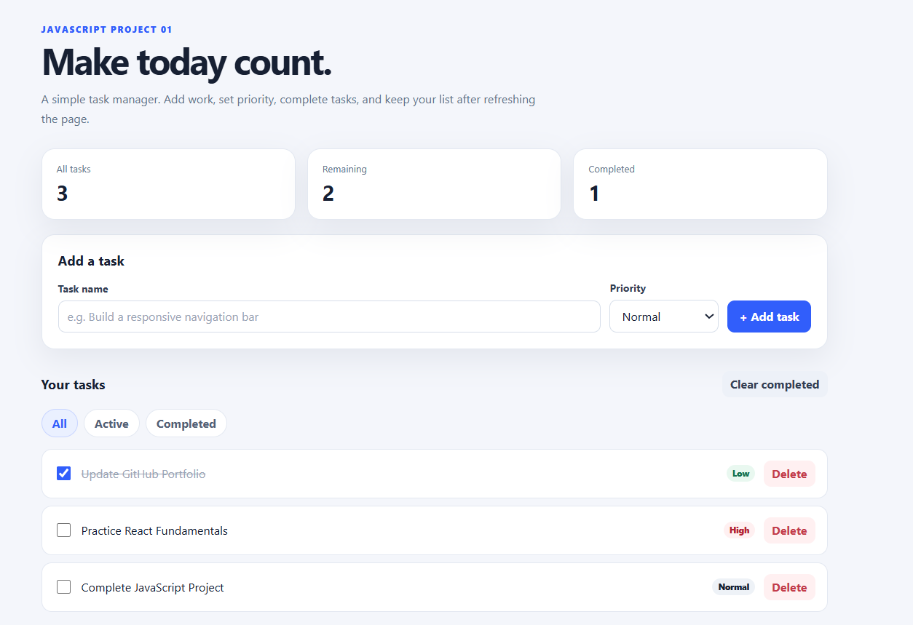

# ✅ JavaScript Task Manager

**A responsive task management app built with HTML, CSS, and vanilla JavaScript.**

Organize daily tasks, set priorities, monitor progress, and keep your task list saved in your browser.

[](https://developer.mozilla.org/en-US/docs/Web/HTML)
[](https://developer.mozilla.org/en-US/docs/Web/CSS)
[](https://developer.mozilla.org/en-US/docs/Web/JavaScript)
[](https://anik339.github.io/javascript-task-manager/)

## 🌐 Live Demo

**[🚀 Open the Task Manager](https://anik339.github.io/javascript-task-manager/)**

## 📸 Project Preview



## ✨ Features

- **Create tasks:** Add a task with a name and a priority.
- **Prioritize work:** Choose a priority level (Low, Normal, or High).
- **Track progress:** See total, remaining, and completed task counts.
- **Complete tasks:** Mark tasks done or active using checkboxes.
- **Filter tasks:** View All, Active, or Completed tasks.
- **Remove tasks:** Delete individual tasks or clear completed tasks.
- **Save automatically:** Keep tasks in browser `localStorage`, including after page refreshes.
- **Responsive layout:** Use the interface on different screen sizes.

## 🛠️ Tech Stack

| Technology | Purpose |
| --- | --- |
| HTML5 | Page structure and forms |
| CSS3 | Layout and styling |
| Vanilla JavaScript | Task handling, filtering, and DOM updates |
| localStorage | Client-side task persistence |
| GitHub Pages | Static site hosting |

## 📁 Project Structure

```text
javascript-task-manager/
├── index.html
├── styles.css
├── script.js
├── task-manager-preview.png
└── README.md
```

## 🚀 Run Locally

1. Clone this repository:

   ```bash
   git clone https://github.com/anik339/javascript-task-manager.git
   ```

2. Open the project folder:

   ```bash
   cd javascript-task-manager
   ```

3. Open `index.html` in a browser. No build tools, packages, or backend setup are required.

## 📖 How to Use

1. Enter a name under **Add a task**.
2. Select **Low**, **Normal**, or **High** priority.
3. Click **+ Add task**.
4. Tick a task's checkbox when it is completed.
5. Switch between **All**, **Active**, and **Completed** filters.
6. Refresh the page to check that the tasks remain saved in that browser.

## 🧠 What I Practiced

- DOM selection and updates
- Event handling
- JavaScript arrays and objects
- Filtering and task-state management
- Browser storage (`localStorage`)
- Responsive UI development
- Publishing a static site with GitHub Pages

## ⚠️ Current Limitations

This is a **frontend-only learning project**. Tasks are saved on the current browser/device, not synchronized across accounts or devices. It does not have authentication, an API, or a database server.

## 🗺️ Planned Improvements

- [ ] Edit existing tasks
- [ ] Add due dates and sorting
- [ ] Add automated tests
- [ ] Improve keyboard and screen-reader accessibility
- [ ] Explore optional cloud sync in a future full-stack version

## 👨‍💻 Developer

**Anik Dey** — Aspiring Full-Stack MERN Developer

- [GitHub Profile](https://github.com/anik339)
- [Full-Stack Learning Journey](https://github.com/anik339/AI-Driven-Full-Stack-Web-Developer-with-MERN)

---

*Built while learning web development, one project at a time.*
